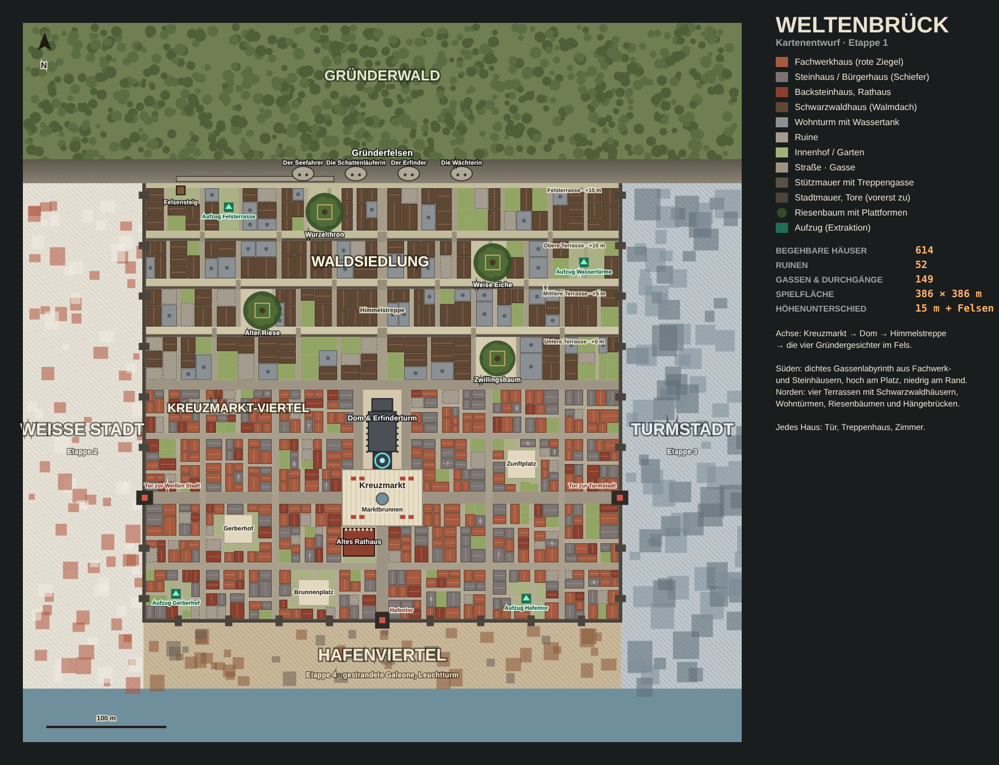

# Damm Raider

Ein Extraction-Shooter für den Browser, inspiriert von **Arc Raiders**. Du steigst aus der unterirdischen
Siedlung Speranza an die Oberfläche, plünderst eine der Karten **„Der Damm“** oder **„Weltenbrück“**,
kämpfst gegen ARC-Maschinen und musst es rechtzeitig zu einem Aufzug schaffen – sonst ist deine
Ausrüstung weg.

Fanprojekt ohne Verbindung zu Embark Studios. Alle 3D-Modelle und Inventar-Icons werden per Skript in
**Blender** gebaut (siehe unten), Sounds und Texturen entstehen zur Laufzeit.

## Spielen

**Einfachste Variante:** `dist/damm-raider.html` im Browser öffnen (Doppelklick). Die Datei enthält
alles – three.js, alle Blender-Modelle und den Icon-Atlas – und läuft ohne Server und ohne Internet
(nur die Schriften kommen von Google Fonts).

**Entwicklung (ohne Build):**

```bash
cd damm-raider
npm install        # nur nötig für den Build
npm run dev        # startet http://localhost:8080
```

`index.html` lädt die ES-Module aus `src/` direkt, three.js über eine Import-Map vom CDN und die
Modelle aus `assets/`. Über `file://` geöffnet fällt das Spiel auf einfache Formen zurück, weil der
Browser dann keine Dateien nachladen darf – dafür gibt es die Einzeldatei.

**Build der Einzeldatei:**

```bash
npm run build      # schreibt dist/damm-raider.html
```

Benötigt wird ein Desktop-Browser mit WebGL, Tastatur und Maus.

## Steuerung

| Taste | Aktion |
| --- | --- |
| W A S D / Maus | Bewegen / Umsehen |
| Linke / rechte Maustaste | Schießen / Zielen |
| Shift | Sprinten |
| Leertaste | Springen |
| C | Ducken (leiser, schwerer zu entdecken) |
| Q | Ausweichrolle |
| V | Nahkampf – schüttelt auch Zecken ab |
| R | Nachladen |
| 1 / 2 / Mausrad | Waffe wechseln |
| E (halten) | Behälter durchsuchen, Aufzug rufen |
| 3 / 4 / 5 | Verband / Sanitätskit / Schildlader |
| G | Splittergranate |
| Tab | Inventar (inkl. sicherer Tasche) |
| M | Karte (Klick setzt eine Markierung) |
| Esc | Pause |

## Spielablauf

1. **Speranza (Hub):** Einsatzgebiet wählen, Ausrüstung zusammenstellen, im Lager verwalten, bei
   Händlerin Celeste kaufen und verkaufen, Rucksack und Lager ausbauen.
2. **Raid:** 20 Minuten an der Oberfläche. Zufällige Bedingung: klarer Tag, Dämmerung oder Elektrosturm
   (schlechte Sicht, mehr ARC, bessere Beute).
3. **Extraktion:** An einem der vier Aufzüge die Konsole bedienen, 25 Sekunden durchhalten (der Lärm lockt
   ARC an), dann einsteigen und 5 Sekunden in der Kabine bleiben.
4. **Tod oder Zeitablauf:** Alles, was du dabei hattest, ist verloren – nur die sichere Tasche kommt ins
   Lager. Ohne Waffe gibt es eine zufällige Gratis-Ausrüstung.

Der Spielstand wird im `localStorage` des Browsers gespeichert.

## Die Karte: Der Damm

- **Talsperre 7** mit begehbarer Dammkrone, Portalkran, Torhäusern und Überlauf mit Wasserfall
- **Stausee** im Norden (man kann schwimmen, aber nicht schießen)
- **Kraftwerk** am Fuß der Mauer mit Turbinen, Druckrohren und Galerie
- **Kontrollturm** mit Brücke auf die Dammkrone
- **Forschungsanlage**, **Wasseraufbereitung**, **Umspannwerk**, **Blasse Wohnblöcke**
- **Giftsumpf** mit Stelzenhütten – das Wasser verätzt
- **Altes Schlachtfeld** mit dem Wrack einer riesigen ARC-Königin
- **Hydrokuppeln** und **Pumpstation** auf dem Plateau am See
- Vier Aufzüge: West, Süd, Ost und auf dem Damm

## Die Karte: Weltenbrück



Eine Fantasy-Stadt aus deutscher Architektur: früher eine freie Handelsstadt mit vier Gilden (Seefahrer,
Schattenläufer, Erfinder, Wächter), heute verlassen, überwuchert und von ARC besetzt. Etappe 1 umfasst
den **Kreuzmarkt** und die **Waldsiedlung**; Weiße Stadt, Turmstadt und Hafenviertel liegen vorerst als
Kulisse hinter der Stadtmauer.

- **Kreuzmarkt-Viertel:** Labyrinth aus engen Gassen (2–4 m), Fachwerk-, Stein- und Backsteinhäusern
  mit 2–7 Geschossen, Läden mit Schildern und Markisen, versteckte Innenhöfe, Ruinen
- **Kreuzmarkt** mit Brunnen und Marktständen, **Altes Rathaus** mit Treppengiebeln und Uhrtürmchen
- **Dom zu Weltenbrück:** begehbares Kirchenschiff mit Bleiglas, Säulen und Chor; der Turm ist bis zur
  Galerie besteigbar, darüber der **Erfinderturm** mit pulsierendem Energiekern
- **Waldsiedlung** auf vier Terrassen (je 5 m höher) mit Stützmauern und Treppengassen,
  Schwarzwaldhäusern und Wohntürmen mit Wassertanks
- **Riesenbäume** mit Plattformen, Baumhütten und Hängebrücken zu den Dächern der Wohntürme
- **Gründerfelsen** mit den Gesichtern der vier Gildengründer; über den **Felsensteig** erreicht man das
  Felsband vor den Gesichtern
- **Jedes Haus ist begehbar:** Türen auf allen offenen Seiten, Treppenhaus über alle Geschosse,
  Zwischenwand mit Durchgang, Möbel, Beuteplätze; Fenster sind echte Öffnungen
- **Fassaden im Detail:** Fachwerk mit vorkragender Schwelle und Balkenköpfen, Andreaskreuzen und
  Riegeln; Putzhäuser mit Natursteinsockel, Eckquadern, Fensterfaschen und Verdachungen;
  Türgewände mit Schlussstein und Trittstufe; Blumenkästen mit Geranien; Regenrinnen mit Fallrohren,
  Ortgangbretter am Giebel; Schwarzwaldhäuser teils mit Holzschindel-Fassade; Efeu in Ranken
- **Stuben:** Eckbank mit Herzausschnitten und Bauerntisch, Brettstühle, Teppiche, Bauernbett mit
  bemaltem Kopfteil, grüner Kachelofen mit Ofenbank und Trockenstange, Kuckucksuhr
- **Wiesen** in Höfen und Gärten: Gräser, Klee, Löwenzahn, Gänseblümchen; Gartenbeete mit Mohn,
  Kornblumen, Margeriten und Ringelblumen
- Vier Aufzüge, die Stadttore sind vorerst verschlossen

Die Stadt entsteht bei jedem Laden gleich aus einem Generator (`src/maps/weltenbrueck/`):
`layout.js` legt Straßen, Gassen, Plätze, Terrassen und Grundstücke fest, `house.js` baut daraus die
Häuser, `build.js` die Sonderbauten, `index.js` Terrain, Materialien und Vegetation.

## ARC-Gegner

| ARC | Verhalten | Schwachstelle |
| --- | --- | --- |
| Zecke | lauert, springt dich an und hängt sich fest | Auge |
| Knaller | rollt heran und explodiert (auch bei Beschuss – Kettenreaktionen!) | – |
| Wespe | schnelle Drohne, feuert Salven | Rotoren (2 zerstört = Absturz) |
| Hornisse | gepanzerte Front, schwere Energiebolzen | hintere Antriebe |
| Späher | ruft Verstärkung, wenn er dich zu lange sieht | Scanner |
| Wächter | Geschütz auf Dächern, Laser-Zielerfassung, dann ein harter Schuss | Linse |
| Raketier | schwerer Flieger mit Raketensalven | Düsen |
| Springer | großer Vierbeiner, springt dich an, Flächenschaden bei der Landung | Kernauge |
| Bastion | Kampfläufer mit Miniguns und Stampfattacke | Rückenkern |

Zerstörte ARC hinterlassen Wracks mit wertvollen Teilen.

## 3D-Modelle mit Blender

Alle Modelle entstehen reproduzierbar per Python-Skript in Blender (`blender/`):

| Datei | Inhalt |
| --- | --- |
| `kit.py` | Modellier-Baukasten (gefaste Boxen, Zylinder, Profile, Drehkörper), Materialpalette, Export |
| `m_weapons.py` | die neun Waffen, jeweils mit Mündungspunkt |
| `m_items.py` | Beutebehälter und Modelle für alle 50 Inventar-Icons |
| `m_arc.py` | die neun ARC-Maschinen mit Gelenken, Rotoren und Trefferzonen |
| `m_world.py` | Container, verlassene Autos (Limousine der 70er und Kastenwagen mit Rost, Chrom, runden Scheinwerfern, Plattfuß), Strommasten, Fensterrahmen, Türen, Portalkran, Turbinen, Radar, Königinnen-Wrack, Aufzug, Laubbaum, Fichte, Büsche, Felsen, Gras mit Ähren, der Raider |
| `m_city.py` | Weltenbrück: die vier Gründergesichter (verwitterter Stein mit Moos), Fenster, Fensterläden, Türen, Gauben, Schornsteine, Ladenschilder, Markisen, Blumenkästen, Balkenköpfe, Möbel (Bauerntisch mit gedrechselten Beinen, Brettstuhl, Eckbank, Bauernbett, Regal, Kachelofen, Kuckucksuhr), Truhe/Schrank/Kommode als Beutebehälter, Laternen, Bänke, Marktstände, Karren, Wassertanks, Marktbrunnen, Ziehbrunnen, Zunftbaum, Fialen, Erfinderturm-Spitze, Uhrtürmchen, Riesenbaum, Linde, Birke, Gartenblumen, Wiesenbüschel, Unkraut |
| `build.py` | baut alles, exportiert `assets/models.glb` und rendert `assets/icons.webp` mit Cycles |

Neu bauen (die fertigen Dateien liegen im Repo, für das Spielen ist Blender nicht nötig):

```bash
python3 -m venv .venv-blender
.venv-blender/bin/pip install bpy==4.5.14      # Blender 4.5 LTS als Python-Modul (Python 3.11)
.venv-blender/bin/python blender/build.py      # oder: blender -b -P blender/build.py
npm run build                                   # Einzeldatei neu erzeugen
```

Konventionen, die das Spiel auswertet:

- Blender-Achsen: Z oben, **+Y vorne** (wird im Spiel zu -Z).
- Benannte Knoten `asset__Name` (z. B. `arc_wasp__Rotor0`, `ch_raider__ArmL`) werden animiert.
- Trefferzonen stehen als Custom Properties an den Objekten: `hit`, `r`, `mult`, `armor`, `hp`, `thruster`.
- Lackflächen in Magenta (`key`) werden im Spiel pro Platzierung umgefärbt (Container, Autos).
- Matte und metallische Materialien werden beim Export in Vertexfarben gebacken, damit das Spiel
  mit wenigen Materialien und Draw-Calls auskommt; leuchtende Teile behalten ihr Material.
- Stadt-Modelle (`m_city.py`) zeigen mit der Vorderseite nach **-Y**, damit Fassadenteile mit derselben
  Drehung wie ihre Wand nach außen zeigen. Teile namens `__Paint` werden pro Instanz eingefärbt
  (Fensterrahmen, Läden, Türen, Markisen, Schilder, Bettdecken, Geranien, Sitzkissen, Balkenköpfe).
- Wiederholte Modelle (Fenster, Läden, Möbel, Laternen …) zeichnet das Spiel als Instanzen
  (`src/instancer.js`); Fassadendetails, Gras und Blumen nur bis etwa 100 m, Möbel nur in der Nähe.

Was nicht aus Blender kommt: Wände, Böden, Treppen und Dächer der Stadthäuser entstehen im Spiel aus
dem Stadtplan, weil jedes Haus genau auf sein Grundstück passen und begehbar sein muss. Alles, was eine
feste Form hat, kommt aus Blender.

## Tests

Browser-Tests mit Playwright liegen in `tools/tests/` (Ladezeit, Bewegung durch Türen und Treppen,
Raids, Detailbilder), Blender-Vorschaubilder erzeugt `blender/preview.py`. Stand, Konventionen und
nächste Schritte stehen in [`docs/weiterarbeiten.md`](docs/weiterarbeiten.md).

## Projektstruktur

```
damm-raider/
├── blender/            Blender-Skripte für alle Modelle und Icons
├── assets/             exportierte Modelle (models.glb) und Icon-Atlas
├── docs/               Kartenentwurf Weltenbrück
├── index.html          HTML-Gerüst (Hub, HUD, Fenster)
├── css/style.css       Oberfläche
├── src/
│   ├── main.js         Einstieg
│   ├── assets.js       lädt models.glb, liefert Klone und Instanz-Geometrie
│   ├── game.js         Spielablauf, Treffer, Explosionen, Extraktion
│   ├── world.js        Szene, Licht, Wetter, Wasser, Vegetation
│   ├── terrain.js      Höhenfeld (Form kommt aus der Kartendefinition)
│   ├── maps/           Kartendefinitionen: damm.js, weltenbrueck/ (Stadtgenerator)
│   ├── map.js          Aufbau der Dammkarte
│   ├── structures.js   Gebäude-Baukasten
│   ├── batcher.js      Zusammenfassen statischer Geometrie
│   ├── instancer.js    wiederholte Blender-Modelle als Instanzen (einfärbbar, mit Culling)
│   ├── collision.js    Kollision und Raycasts
│   ├── player.js       Spielfigur, Kamera, Waffen, Heilung
│   ├── enemies.js      ARC-KI
│   ├── arcmodels.js    ARC-Modelle
│   ├── projectiles.js  Geschosse, Raketen, Granaten
│   ├── loot.js         Behälter und Beutetabellen
│   ├── props.js        Aufzüge, explosive Fässer
│   ├── items.js        Gegenstände und Waffenwerte
│   ├── hud.js / ui.js  HUD und Menüs
│   └── audio.js        synthetisierte Sounds
└── tools/build.mjs     Einzeldatei-Build (esbuild)
```
